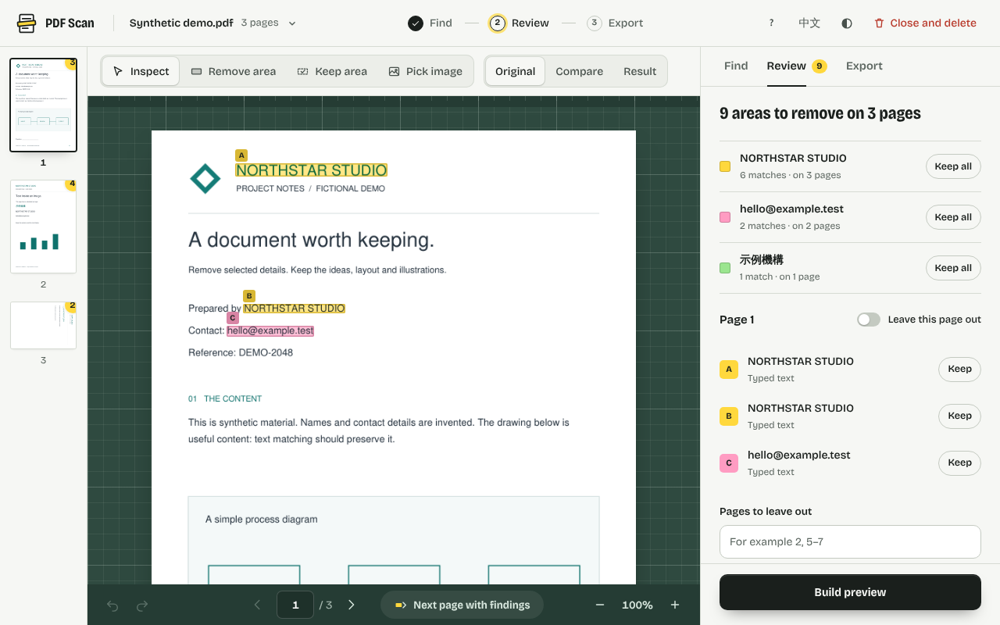
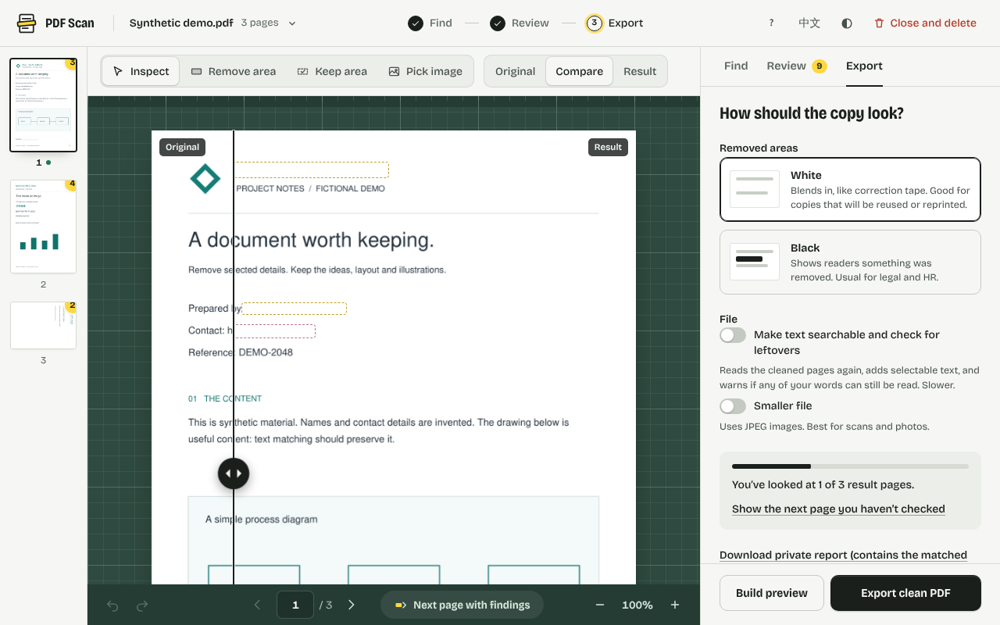
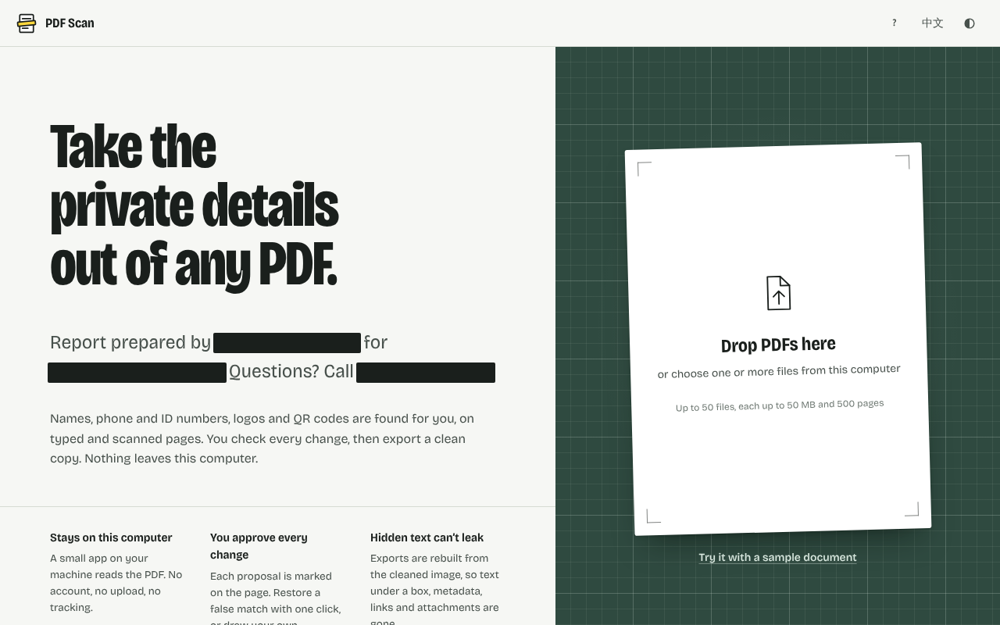
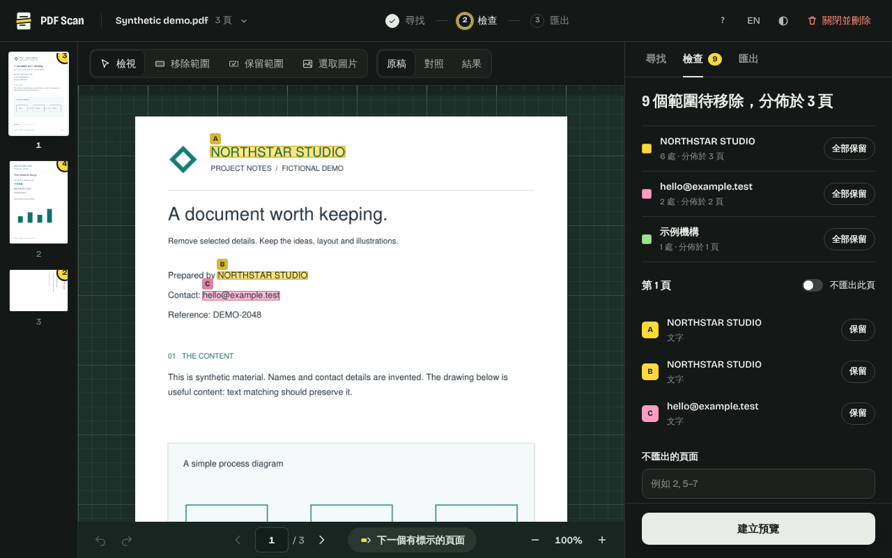

# PDF Scan

Take the private details out of a PDF on your own computer. PDF Scan finds names, phone and ID numbers, email addresses, links, QR codes and logos, including on scanned pages. You check every proposal on the page, then export a clean copy that is rebuilt from pixels, so nothing hidden under a box can leak.

**No accounts, uploads, cloud processing or telemetry.** A small Python service runs on your machine and the browser page talks only to it. Setup downloads dependencies and OCR models once; processing never needs the internet.



## Who it is for

- **Anyone sending a document**: a CV, tenancy agreement, invoice, bank statement or application form, without the names, addresses, phone and ID numbers that the reader doesn't need.
- **HR, legal and admin staff** sending files outside the organisation: black-box redaction of names, ID and card numbers, with a check that nothing is still readable.
- **Companies and freelancers** removing letterheads, logos, QR codes, client names and contact details before sharing drafts, quotes, reports or portfolio samples.
- **Researchers and journalists** de-identifying forms, survey responses and source documents before they are published or shared.
- **Schools, teachers and students** reusing papers, worksheets and notes: remove school names, crests and personal details, and keep the questions and diagrams.

## What it does

| | |
| --- | --- |
| **Find** | Your words and names (whole words, any case, with or without punctuation, Traditional or Simplified forms), on typed pages and on scans, including text inside ruled tables and pages scanned sideways or upside down. OCR tolerates small reading errors and labels those as close matches for you to check. Opt in to email addresses, phone numbers (including spaced formats such as `+852 2345 6789`), payment card numbers (Luhn-checked), ID numbers (HKID, Taiwan, mainland China and US SSN, all checksum-validated), web links and link areas, QR codes, logos, a specific logo you upload, or independently removable watermarks. |
| **Review** | Each found group gets its own highlighter colour on the page and in the list. Keep a single match or a whole group, draw extra areas to remove or keep, leave pages out, and undo or redo any change. A page rail shows how many areas each page has. |
| **Adjust** | Select any box to move it, resize it with its grips, or type its exact position and size in millimetres. Apply a change to that box only, or to every match in its group: widen the box around one client name and every match of it on other pages follows, in proportion to its size. |
| **Compare** | Original, Compare (drag the divider) and Result views. On the result, dashed outlines show exactly where something was removed. The export panel tracks which result pages you have looked at. |
| **Export** | White (like correction tape) or black (shows a removal) boxes; lossless or smaller JPEG pages; optionally **searchable text plus a leftover check** that re-reads the cleaned pages and warns if any of your words can still be read. |
| **Safe output** | Pages are rebuilt from the cleaned image. The file has no source metadata, bookmarks, links, annotations, attachments or hidden text. Originals are never changed. |

Other details: open up to 50 PDFs at once and export them as one zip; progress and Cancel for long documents; resume after an accidental reload; English and 繁體中文 interface; light and dark themes; full keyboard support (press <kbd>?</kbd>); works on phones and tablets.



<p> </p>

## How it compares

| | PDF Scan | Acrobat Pro redaction | Stirling-PDF | Online PDF sites |
| --- | --- | --- | --- | --- |
| Files stay on your computer | Yes | Yes | Self-hosted server | No, uploaded |
| Finds text on scans | Built-in OCR | After a separate OCR step | Separate OCR step | Varies |
| Logos, QR codes, repeated images | Yes | No | No | No |
| Checksum-validated card and ID numbers | Yes | Patterns, region-dependent | Regex | Rarely |
| Hidden text, metadata and attachments removed | Always | Only if you run "Sanitize" | Option | Varies |
| Cost | Free, open source (MIT) | Subscription | Free, self-hosted | Free tiers and limits |

Based on each product's public documentation in 2026; check current versions before relying on a row. Trade-off: exported pages are images. Turn on **Make text searchable** for selectable, searchable text rebuilt from the cleaned pages.

## Quick start on Windows

Install Python 3.10 or newer, then download or clone this repository. From its folder:

```powershell
.\Setup.ps1
.\Start.ps1
```

After setup, double-click `start.cmd`. It starts the service and opens [the local review page](http://127.0.0.1:8765). Keep the window open while you use the app, and stop it with Ctrl+C. Use another port with `.\Start.ps1 -Port 8766`. The batch launcher allows the script for that process only and does not change your PowerShell execution policy.

## Quick start on Linux / macOS

```bash
python3 -m venv .venv
. .venv/bin/activate
python -m pip install -e '.[dev]'
python scripts/setup_ocr.py
python -m pdfscan serve --open-browser
```

The setup script downloads the OCR models once and verifies their checksums: the PP-OCR reader (about 75 MB download, 30 MB kept) and the Tesseract English and Traditional Chinese models used as a fallback. After that, nothing needs the internet.

## Using it

1. **Open** one PDF or several, or choose **Try it with a sample document**.
2. **Find**: type words and names, one per line, and switch on anything else to look for. Choose **Find on every page**.
3. **Review**: go through the pages (the rail and **Next page with findings** help). Choose **Keep** on false matches, or **Keep all** for a whole group. To adjust a box, click it (or its name in the list): drag it to move, drag a grip to resize, or type Left, Top, Width and Height. Under **Apply changes to**, choose **This box** or **All** to change every match of that word on every page; **Reset** returns boxes to the size that was found. Draw with **Remove area** or **Keep area**: drag, click two opposite corners, or use the keyboard (focus the page, move with the arrow keys, press Enter at two corners). Turn on **Leave this page out**, or type page numbers such as `2, 5–7`.
4. **Build preview**, then look through the result in Compare or Result view.
5. **Export clean PDF**. The file is named `<original name> (redacted).pdf`.

### Several PDFs at once

Drop or choose up to 50 PDFs together, or add more later from the file menu (click the file name at the top). The words and options on **Find** apply to every file, so **Find in all files** searches them all in one go. Review each file in turn: the file menu, **Next page with findings** (which carries on into the next file) and the <kbd>[</kbd> <kbd>]</kbd> keys move between them. Each file keeps its own review choices, kept matches, adjusted boxes and pages left out.

On **Export**, the file list shows where each one stands: Find needed, preview not built yet, or how many result pages you have looked at. **Build all previews**, then **Export zip** downloads one `Redacted PDFs (n files).zip` with each file named `<original name> (redacted).pdf`. Any missing previews are built before zipping, and a warning lists files with result pages you haven't looked at.

Any change after a preview marks it out of date, and export always uses the exact preview you built. **Keep area** preserves original pixels, including any found match inside it; nesting settles overlaps: a Keep area drawn inside a Remove area stays, and a Remove area drawn inside a Keep area is removed.

### What each option finds

- **Words and names** match native text and OCR text, on whole words or word runs within one line. Hyphens, slashes, other punctuation and Chinese characters count as word breaks, so "ACME" is found in "INV-ACME-2026"; letters inside a word never match, so "cat" is not found in "category". Use other spellings on extra lines, or draw an area for text split across lines.
- **Look in** limits matching to the whole page, the top quarter or the bottom quarter.
- **Logos (best guess)** proposes compact artwork in headers and footers. It can mistake diagrams or decorations for logos, so check these.
- **Find a specific logo** searches every page for your uploaded image (PNG, JPEG or WebP, up to 5 MB) at any size and right-angle rotation. It can miss distorted or very low-resolution copies.
- **Web links** finds printed URLs and clickable link areas. Links are never opened.
- **QR codes** are found by their finder patterns; their contents are never decoded.
- **Pick image** (page tool) selects an embedded image; Find then marks every identical copy.
- **Watermarks** is off by default. Turn it on to find separate text watermarks using the wording you enter above, plus recognised scanner-app and website captions. With this option on, picked image watermarks use object removal when it can be verified. See the review rules below.
- **Document type: Exam or test paper** is an optional mode for schools. It also suggests crests next to headings and instruction or cover pages. Check these carefully.

The default PP-OCR reader handles English and Chinese together. If its models are missing, PDF Scan falls back to Tesseract; to add a Tesseract language, put its official `.traineddata` file in `.runtime/tessdata` and use its code in a settings file.

### Removing watermarks without covering questions

1. On **Find**, enable **Watermarks**. For school or company wording, enter the
   complete watermark text in **Words and names**, one spelling per line. Known
   scanner captions such as CamScanner and website labels are recognised without
   adding a text target. Use **Pick image** for an embedded image watermark.
2. Run **Find**, then review proposals labelled **Separate watermark object** or
   **Separate image object**. PDF Scan verifies that removing an independent text
   paint or image/Form XObject leaves other visible text and graphics unchanged.
   A watermark inside a form split over several text operations is supported when
   the complete form can be removed independently.
3. Build the preview and compare the questions, diagrams and tables underneath.
   **Keep**, group controls, undo/redo and normal reviewed export still apply.

A **Keep area** touching an object watermark keeps that entire object. Moving or
resizing its proposal deliberately switches to filling the edited rectangle; reset
its box to return to object removal. Drawn removals still use white or black fill.
An unchanged object proposal removes the watermark itself, without filling its
bounding box, even when black fill is selected. Searchable exports read the cleaned
pixels, so suppressed watermark text is not copied from the original PDF.

For flattened scans, OCR can propose removing a recognised scanner/domain caption
only in an isolated white page margin. Broad text watermarks blended through scan
content, mixed forms containing useful questions/graphics, unknown repeated
publisher labels, PDF text clipping masks and unsupported objects stay intact with review warnings. Detection
can miss marks; inspect every page. Watermarks alone do not cause page removal.
Normal occurrences of your entered words still produce ordinary text-box proposals.

For CLI or saved rules, add `"watermarks": true` (see
[examples/watermarks.json](examples/watermarks.json)). Existing rules without it
remain off. Use watermark plans with the updated engine; older installations do
not implement the new object-removal methods.

## OCR accuracy

Scanned pages are read with PP-OCR (PaddleOCR's detection and recognition networks, run locally with ONNX Runtime). It replaced Tesseract as the default after measuring both on fictional forms, letters and exam papers in English and Traditional Chinese with ruled tables, answer boxes and realistic scan damage. The table shows the share of private details whose whole box was covered by a removal:

| Held-out set (60 pages, 331 details) | PP-OCR (default) | Tesseract (fallback) |
| --- | --- | --- |
| Fully covered | **98.8%** | 47.4% |
| Missed (less than half covered) | **0** | 155 |
| Names / ID numbers / card numbers | 100% / 100% / 100% | 24% / 8% / 0% |
| Seconds per page (same CPU) | 2.8 | 3.4 |

On a harder stress set (30 pages of faint, small, heavily compressed print, many scanned sideways or upside down), PP-OCR fully covers 95.6% against Tesseract's 11%. Tesseract's biggest blind spot was text inside ruled table cells, where forms keep names and numbers. Reproduce the numbers with `benchmarks/ocr/` (see its README). Synthetic scans are not real documents, so keep reviewing every page.

## Command line

```bash
python -m pdfscan demo .runtime/demo.pdf
python -m pdfscan detect .runtime/demo.pdf --rules examples/rules.json --plan .runtime/plan.json --cache .runtime/cache
python -m pdfscan apply .runtime/demo.pdf --plan .runtime/plan.json --decisions examples/decisions.json \
    --output .runtime/cleaned.pdf --reviewed --fill black --searchable
```

`--reviewed` confirms you inspected the plan and decisions. `apply` exits with code 2 if `--searchable` finds your targets still readable.

Batch a folder with the same rules. Every proposal is applied without visual review, so you must say so explicitly and then inspect each output:

```bash
python -m pdfscan batch ./to-share --rules examples/rules.json --output-dir ./shared --accept-proposals --searchable
```

The batch writes `batch-summary.json` with regions removed and any leftover warnings per file.

## Python API

```python
from pdfscan.engine import detect, apply

plan = detect("input.pdf", {"text": ["Example Company"], "phone": True, "ids": True, "ocr": True,
                            "languages": "eng"}, tessdata=".runtime/tessdata")
result = apply("input.pdf", plan, {"output": {"fill": "black", "searchable": True}}, "cleaned.pdf",
               tessdata=".runtime/tessdata")
print(result["residual"])  # [] when none of the targets can be read in the output
```

Rectangles are `[left, top, right, bottom]` between 0 and 1 in displayed page space; pages are numbered from 1. Review decisions may include `"adjusted": {"<detection id>": [left, top, right, bottom]}` to replace a found box. `detect` and `apply` accept `progress(stage, done, total)`, which may raise to cancel. The source SHA-256 and plan hash are checked before applying; the hash detects accidental changes and is not a signature.

## Output and limits

Pages are rendered at 200 dpi (lower for very large pages, to stay within 5000 pixels a side). Input limits: 50 MB, 500 pages, unencrypted PDFs, page sides up to 14,400 points. OCR can still miss faint, damaged, handwritten or unusual text. This is a review tool, not a guarantee that everything sensitive was found: inspect every page you export.

PDF parsing is not an antivirus or a sandbox. Do not expose the development server to a network.

## Privacy and local files

- Documents, previews and OCR caches live in `.runtime/jobs/`. **Close and delete** removes the open files and any zip made from them. Everything left from an earlier run is deleted when the app starts again, and the least recently used document is freed if 60 are open.
- To resume after a reload, the browser tab keeps the document ID, your words and your review choices in session storage. It is cleared when the tab closes.
- OCR caches and the private report contain original text. Keep them private; share only the cleaned PDF.
- The service binds to `127.0.0.1`, checks Host and Origin, needs a per-process token for changes, and serves no route for the original PDF.

## Development

```bash
python -m pytest -q --basetemp=.runtime/test-run
python scripts/prepare_release.py --audit-only
```

Tests use fictional generated documents; OCR tests need the default models. Measure OCR changes with the benchmark in `benchmarks/ocr/`. See [CONTRIBUTING.md](CONTRIBUTING.md) for the workflow and [DESIGN.md](DESIGN.md) for the interface's design rules.

```text
pdfscan/        Engine, CLI, local server and sample generator
pdfscan/web/    Review page, styles, translations and bundled font
tests/          Engine, server and visual regression tests
examples/       Example rules and review decisions
scripts/        OCR setup and allowlisted source release
benchmarks/     Synthetic scanned-document OCR benchmark
docs/screenshots/ Fictional sample screenshots for this guide
LICENSES/       Licence texts for bundled third-party data
.runtime/       Private generated files, never committed
```

## Licence

PDF Scan's source code is released under the [MIT License](LICENSE).

It depends on libraries and data with their own licences, listed in [THIRD_PARTY_NOTICES.md](THIRD_PARTY_NOTICES.md). The one to know about is **PyMuPDF**, which is licensed under the **GNU AGPL-3.0** or a commercial licence from Artifex. Installing PDF Scan with `pip` downloads PyMuPDF separately, so using PDF Scan or changing its MIT code is unaffected. But if you distribute PDF Scan *together with* PyMuPDF, for example as an installer, a frozen executable or a container image, that combined distribution must meet the AGPL's terms (or you need a commercial PyMuPDF licence). This is not legal advice.

The bundled Bricolage Grotesque font is under the SIL Open Font License 1.1 (`pdfscan/web/fonts/OFL.txt`), and the Traditional/Simplified Chinese table is derived from OpenCC under Apache-2.0 (`LICENSES/Apache-2.0-OpenCC.txt`).
